<div align="center">

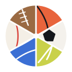

# SportsDash

**Ten sports · 50+ leagues · one self-hosted screen**

</div>

A single-user, self-hosted **sports dashboard** for a wall display, a
desktop tab, or your phone. Follow teams — or whole leagues — across **ten
sports** and 50+ competitions, and see today's games, live scores, a full
calendar, standings, stat leaders, playoff brackets, rosters, results, news,
and a world map of stadiums, all in one place. Get push notifications when a
game is about to start, a period begins, or a final goes in the books. It is
drawn like a printed scorecard: sharp corners, heavy rules, and one spot
colour, which can be your team's.

Everything runs on your own machine. Run it as a **server** with
`docker compose up` and open it in any browser, or build it as a **native
macOS app** that double-clicks open with the backend bundled inside — see
[Running SportsDash](#running-sportsdash). No accounts, no tracking, one
user: you. Data comes live from ESPN and TheSportsDB — no API keys required.

Sports covered: **basketball, baseball, soccer, hockey, American football,
tennis, MMA, golf, motorsport, and volleyball.**

## Screenshots

[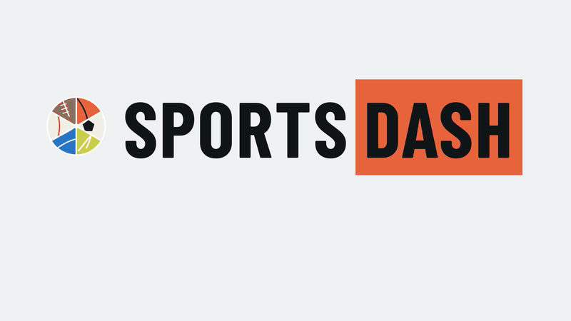](docs/trailer.mp4)

*The preview plays inline on GitHub. Click it for the full trailer, 25
seconds in 1080p with sound.*

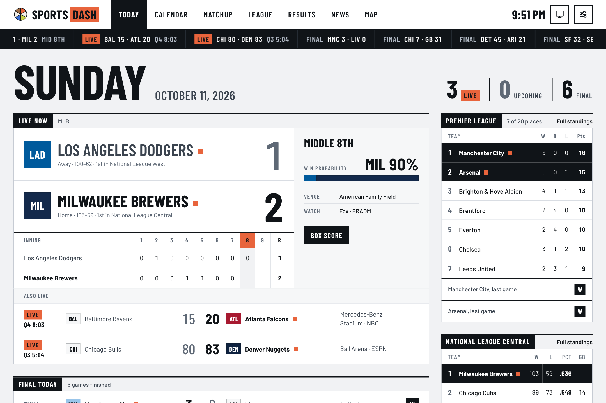

| Matchup | League |
|---|---|
| 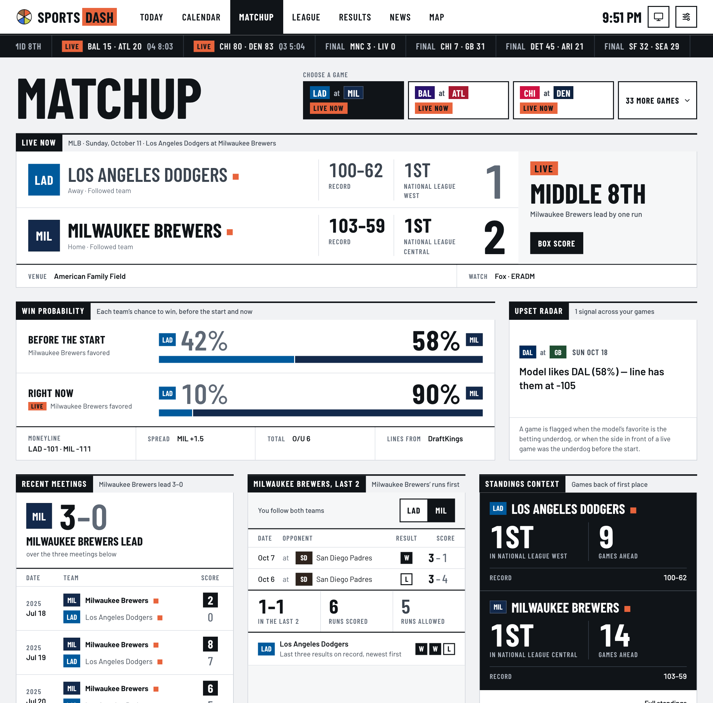 | 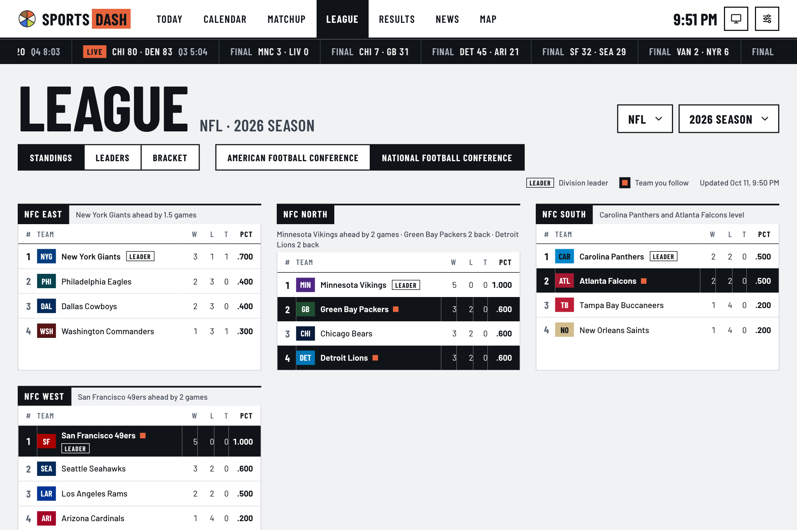 |
| **Calendar** | **Results** |
| 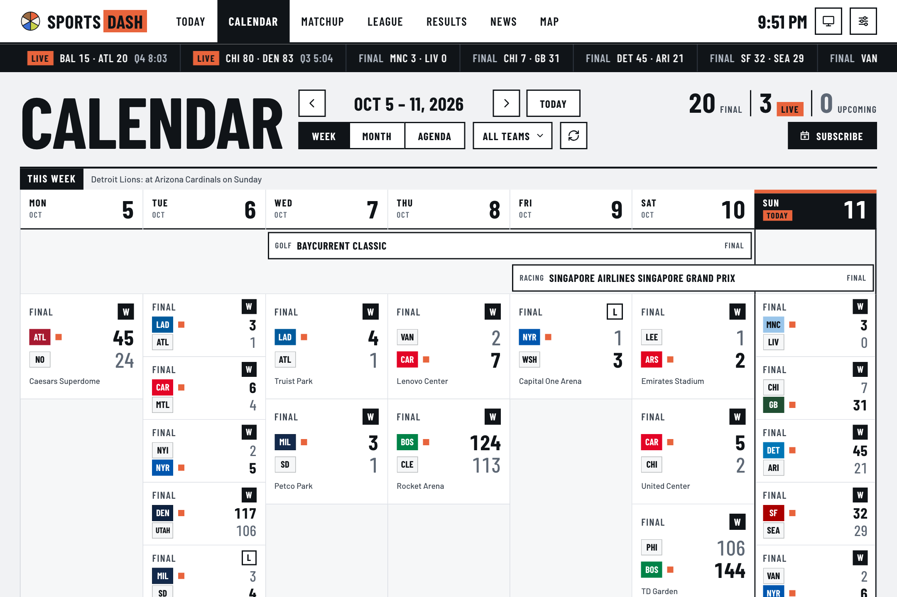 | 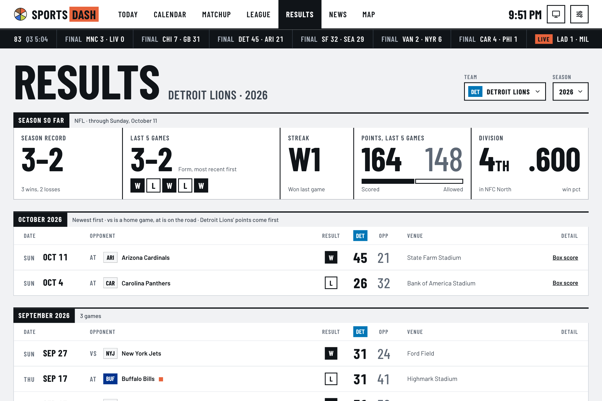 |
| **Stat leaders** | **News** |
| 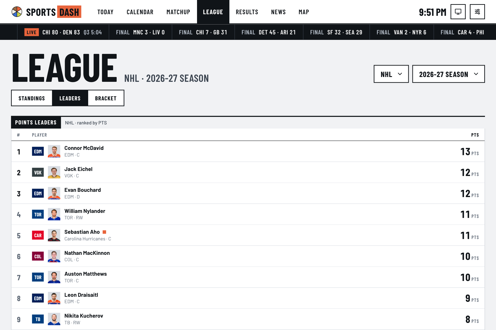 | 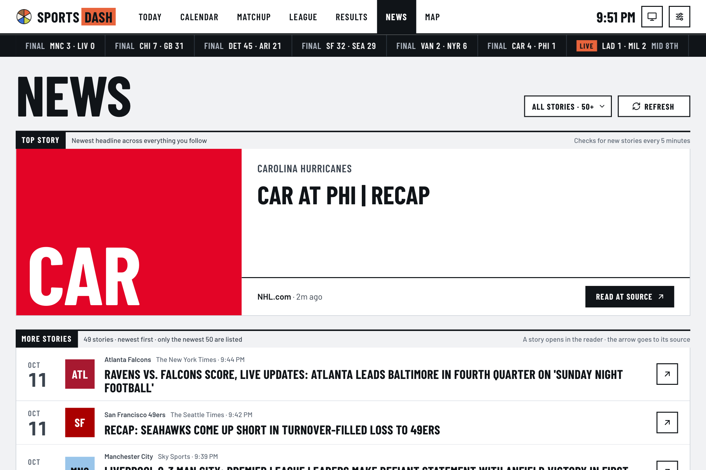 |
| **Map** | **A stadium up close** |
| 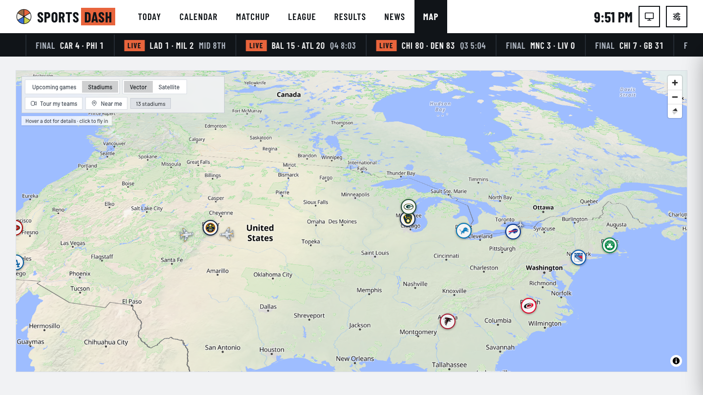 | 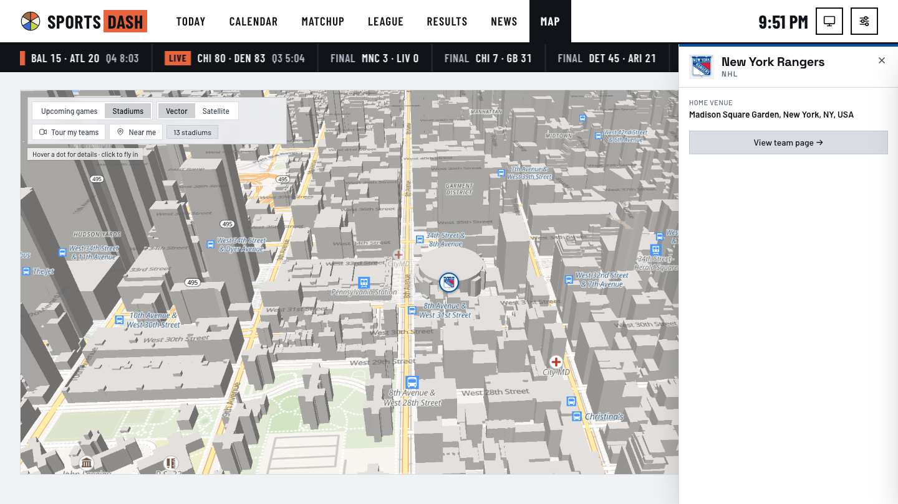 |

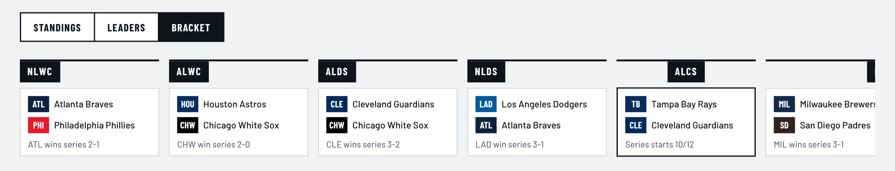

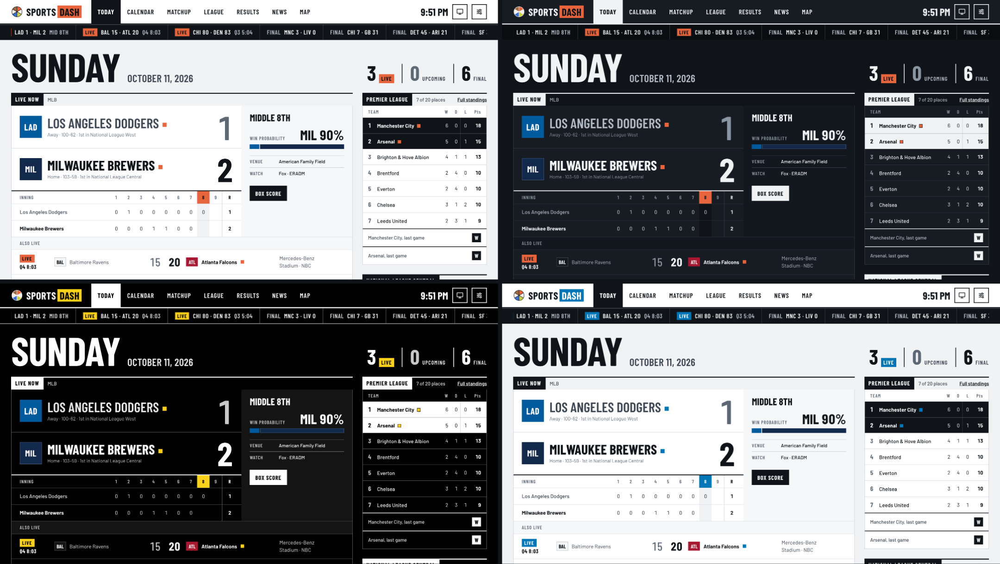

*Light, Dark, High contrast, and Light with a followed team's colour as the
spot colour.*

The screenshots and the trailer show real data from one evening, Sunday,
October 11, 2026. `frontend/scripts/capture-screenshots.mjs` regenerates the
screenshots from a running app.

## Features

- **Today** — every game for the teams and leagues you follow, on one
  sheet. A game in progress leads the page as a **Live now** hero with its
  line score, live win probability, venue, and where to watch; any other
  live games sit under it, then what is still to come, the day's finals, and
  last night's. Scores refresh by themselves, faster while a game is in
  progress. A row names the broadcast when the provider gives the networks
  and the favorite (a win percentage or a moneyline), and carries a small
  why-watch flag when a game is tight late, an upset watch, or a toss-up.
  Click any row for a box score (line scores + top performers, plus
  highlight clips where ESPN has them). Beside the games are the standings
  your teams sit in; under them, the next seven days. In-progress golf and
  race-weekend leaderboards sit here too, as the top three and anyone you
  follow — open one for the full field, where a race board names each car's
  constructor, number, and grid slot, shows a running gap while the race is
  on wherever ESPN publishes one for that car, and once the race finishes
  fills in the race time, the gap (`+15.080`, `+1 lap`), DNF, or DSQ.
- **Calendar** — your games by **week** (the default), **month**, or as an
  **agenda**, with a W or L on each of your teams' finals, multi-day golf
  tournaments and race weekends drawn as bars across their days, and a
  coming-up list with the forecast for outdoor games, plus an `.ics` /
  `webcal://` feed you can subscribe to from any calendar app.
- **Matchup** — one game at a time, live or coming up in the next two
  weeks: both records, win probability before the start and right now,
  betting lines (moneyline, spread, total), recent meetings with the record
  across seasons, your team's recent form, where each side sits in its
  table, projected lineups, and injuries. An upset radar flags a game when
  the model's favorite is the betting underdog, or when the side ahead in a
  live game was the underdog before the start.
- **Standings** — per-league tables with sport-appropriate columns and
  conference/division grouping, the league's top-ten leaders beside them,
  and a panel for each team you follow there (record, place, form, next up).
- **Leaders** — league-wide stat leaders (points, home runs, goals…), with
  the soccer Golden Boot derived from match scorers. Your players highlighted.
- **Bracket** — soccer cup knockouts (e.g. the World Cup) and the US leagues'
  best-of-N **playoff series** (NBA/NHL/MLB), grouped by round through the
  finals.
- **Rosters** — in each team's profile: players, positions, jersey numbers,
  season stat lines, and injury status.
- **Follow individual players** — star players on any followed roster;
  they're highlighted on the Leaders boards and you get injury-status
  alerts, plus a ruled-out heads-up shortly before their game starts.
- **Results** — one team's season at a time: its record, its last eight
  games as a form strip, the current streak, what it scored and allowed
  over those games, and its place in the table; then every final by month,
  with the box score a click away, and the games still to come.
- **Season archives** — jump any ESPN league or team back up to 15 years:
  past-season standings tables (archived in the DB after one fetch) and
  full past-season results, straight from the season pickers on the
  League and Results views.
- **On this day** — a box on Today with each followed team's past games
  that fell on today's date, pulled from the last five seasons of archives.
- **News** — aggregated headlines (ESPN + Google News + RSS): a top story,
  a filter for each team or league you follow, and an in-app reader.
- **Map** — your followed teams' (and every active competition's) home venues
  on a MapLibre map with 3D buildings; click a pin for stadium facts and
  fixtures. A team whose ground can't be pinned accurately is left off rather
  than placed approximately.
- **Team & nation profiles** — click a team in a standings table or on the
  map to open one page for it: next match, recent form, fixtures, results,
  roster, news, and stadium.
- **Score line** — a band under the masthead that carries today's scores on
  every tab. It can be switched off in Settings.
- **Notifications** — pushed to your own [ntfy](https://ntfy.sh) topic:
  starting soon, game start, period start, intermission, final, and a
  followed player's injury or scratch. Injury alerts don't wait for the
  daily sync: a followed team's roster is re-checked in the hours before
  kickoff, so a same-day scratch reaches you the same afternoon.
  Deduplicated, so the same alert never fires twice.
- **Themes & kiosk** — three bases (Light, Dark, and a WCAG-AAA High
  contrast) and, on Light and Dark, a choice of spot colour: the SportsDash
  orange, or the colour of the team you pick as your favourite. A kiosk
  mode that rotates through the tabs, scales the layout up to fill a wall
  display, and shows a clock when idle; and an installable PWA.

## The pages, one by one

The dashboard is a single-page app with seven tabs across the top, plus
the panels and sheets that open over it.

| Tab | What you see / do |
|---|---|
| **Today** | The landing page: every game for your follows on the local calendar day. A game in progress leads as the **Live now** hero (line score, win probability, venue, where to watch) with any other live games under it; then the games still to come, **Final today**, and last night's. It refreshes by itself — fast while a game is in progress, slow otherwise. Click a row for a **box score**. To the side: up to three standings boxes for the tables your teams are in, and **On this day**. Below: **Next 7 days**. In-progress golf and race-weekend leaderboards show up here too, as the top three and anyone you follow; the full board is a click away, and a race board carries each car's constructor, number, and grid slot, plus its race time, gap, DNF, or DSQ once the race is over. A live race board shows the field, the lap count ("Lap 44 of 70"), and a running gap for each car wherever ESPN publishes one. |
| **Calendar** | All your fixtures by **Week** (the default, Monday first), **Month**, or as an **Agenda**, with a team filter and counts of finals, live games, and games to come. Golf tournaments and race weekends span the days they run over (click one for its leaderboard — they show under *All teams*, since a tournament belongs to no team). Under the grid: what is coming up, with a forecast for outdoor games, and a legend of who you follow. **Subscribe** hands you ready-made `webcal://` feeds (all games, or one per team) and an `.ics` download. |
| **Matchup** | One game at a time, picked from the games that are live or within the next two weeks: the game sheet with both records, **win probability** before the start and right now, betting lines, an upset radar, recent meetings with the record across seasons, your team's recent form, each side's place in its table, projected lineups, and injuries. |
| **League** | Pick one of your leagues (and, for ESPN team sports, a season) and drill in through three sub-tabs: **Standings** (sport-appropriate columns, conference/division grouping, a top-ten leaders board, and a panel for each team you follow), **Leaders** (stat leaders, or the soccer Golden Boot), and **Bracket** (cup knockouts and best-of-N playoff series, grouped by round). Leaders and Bracket are for the current season only. |
| **Results** | One followed team's season: record, last-eight form, streak, scoring, and place in the table, then every **final** by month, newest first, and the next games. Pick the team and the season at the top. |
| **News** | Aggregated headlines (ESPN + Google News + RSS): a top story, the rest newest first, a filter for each team or league you follow, and an in-app reader. |
| **Map** | Your followed teams' — and every active competition's — home venues on a MapLibre world map with 3D buildings. Click a pin for stadium facts, current weather, and upcoming fixtures there. A pin only appears once the ground is known well enough to place it precisely; a team whose stadium no data source names stays off the map instead of being dropped on the middle of its county. |

**Panels and sheets (click to open):**

- **Box score** — click any game: line scores, top performers, win
  probability and odds, key moments, and highlight clips where ESPN has them.
- **Team / nation profile** — click a team in a League standings table, or
  its pin on the Map, to open one page for it: next match, recent form,
  fixtures, results, roster, news, and home stadium (with a jump-to-Map
  button).
- **Setup wizard** — *Manage teams* (and the first-run screen): choose
  leagues and teams, or **Follow all** a whole competition. *Manage teams*
  opens on what you already follow, and saving keeps everything you left
  selected, with its data.
- **Settings** — the appearance (base, colours, and the favourite team the
  Team colours come from) and the score line switch. Kiosk mode has its own
  button in the masthead.

## Architecture

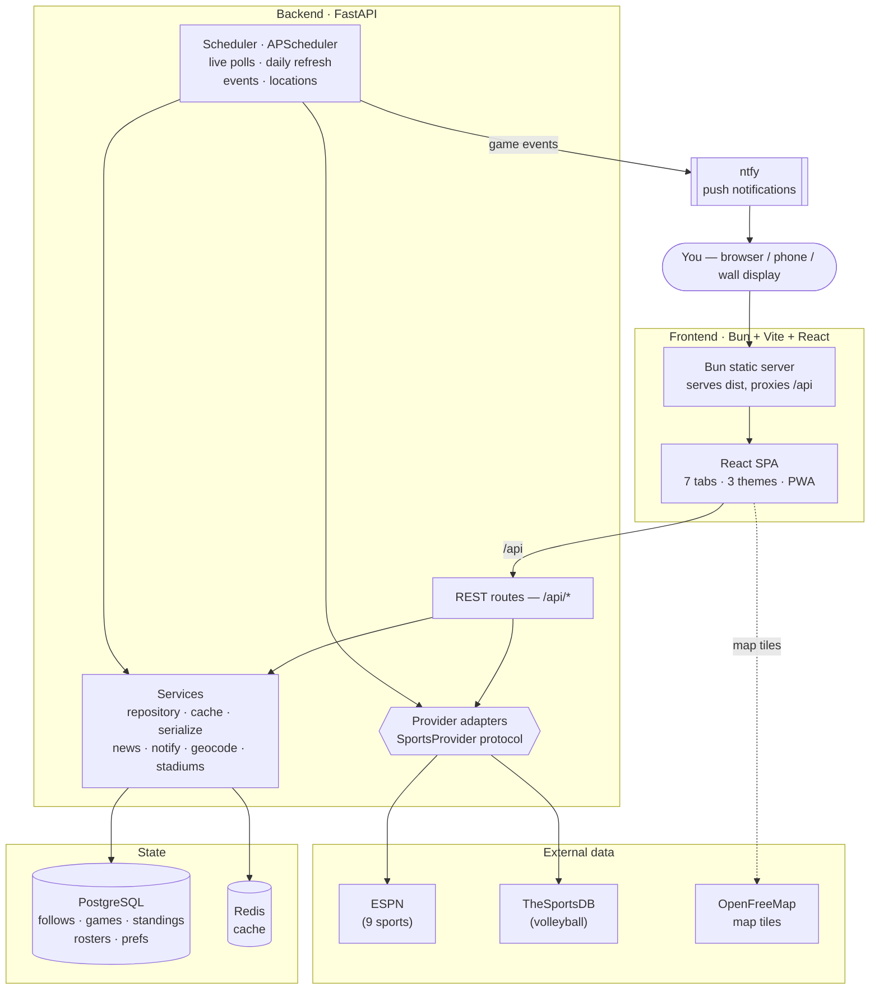

Two principles shape the codebase:

- **Provider adapters.** Every data source implements the `SportsProvider`
  protocol (`backend/app/providers/base.py`) and normalizes its payloads into
  shared domain models — including sport-specific period semantics (`Q3`,
  `2nd Half`, `Top 5`, `P2`, `Set 3`). Routes, services, and the scheduler
  never see provider- or sport-specific fields, so adding a source or a sport
  rarely touches them. ESPN backs nine sports; TheSportsDB backs volleyball.

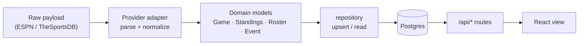

- **UTC internally.** Every stored or compared datetime is timezone-aware
  UTC. Your configured timezone (`SPORTSDASH_TIMEZONE`) is applied only at the
  response boundary ("today" computation, the daily refresh hour) and in the
  frontend's display formatting.

**Stack:** React + Vite + Tailwind v4 + TanStack Query + MapLibre GL
(frontend, served by Bun); FastAPI + SQLAlchemy (async) + APScheduler
(backend); PostgreSQL for storage, Redis for caching, ntfy for push. Tests
and local dev run on SQLite with zero setup. Redis is optional: without it — the desktop app, local dev —
the caches in front of ESPN and the weather service are kept in the
backend's own memory instead, so a view that refreshes does not repeat every
upstream request.

## Running SportsDash

SportsDash runs **two ways from the same codebase** — pick whichever fits.
Both are single-user and self-hosted, and choosing one takes nothing away
from the other.

### Option A — Docker (browser)

The server deployment: runs anywhere Docker does, reached from any browser on
your network (a laptop, a phone, a wall display).

```sh
cp .env.example .env       # set your timezone
printf 'SPORTSDASH_NTFY_TOPIC=%s\n' "$(openssl rand -hex 16)" >> .env
docker compose up -d --build
```

The second line is not optional: the bundled ntfy server runs with no auth,
so the topic name is the only thing keeping your alerts private. There is
deliberately **no default** — `docker compose up` refuses to start until
`SPORTSDASH_NTFY_TOPIC` is set, and it should be a random string, not a
guessable one.

Then open:

- Dashboard — <http://localhost:3000>
- API docs (Swagger) — <http://localhost:8001/docs> (port 8001 is bound to
  loopback, so Swagger is reachable from the host only; the dashboard proxies
  `/api` internally, so other devices never need this port)
- ntfy — <http://localhost:8090>

On first load the dashboard opens the **setup wizard**: choose the leagues
and teams you want, and SportsDash pulls their live data from ESPN /
TheSportsDB and starts populating every view.

For game notifications on your phone, install the ntfy mobile app, add your
server (`http://<your-host>:8090`), and subscribe to the topic you generated
above (`SPORTSDASH_NTFY_TOPIC`).

> **Trust model — no auth, so mind the network.** SportsDash is single-user
> and has no login. The dashboard on `:3000` is published to your LAN on
> purpose (that's the wall display / phone entry point) and it proxies every
> `/api` path and method straight through, so *any device that can reach
> `:3000` can reach the whole API* — including the mutating endpoints (`POST
> /api/setup/follow` rewrites your followed set, `PUT
> /api/notifications/prefs`, `POST /api/news/refresh`). Binding the API's own
> port to loopback is not a security boundary; it only avoids a second,
> unproxied entry point and keeps FastAPI's `/docs`, `/redoc` and
> `/openapi.json` off the LAN. The ntfy port `:8090` is LAN-exposed too, and
> unauthenticated. On an untrusted or guest network, put the whole stack
> behind an authenticating reverse proxy or a VPN — moving ports around will
> not help.

### Option B — macOS desktop app

A native `SportsDash.app` you double-click — **no browser, no Docker, and no
Python to install.** Download the
[latest macOS release](https://github.com/Mpawlowski5467/SportsDash/releases/latest),
or build it locally with one command:

```sh
./scripts/build-desktop.sh
```

This produces `SportsDash.app` (and a shareable `.dmg`) under
`frontend/src-tauri/target/release/bundle/`. Drag the app to `/Applications`
and open it — the bundled backend boots, then the same first-run setup wizard
appears. Architecture, prerequisites, where the database lives, and
code-signing notes are documented in **[docs/desktop.md](docs/desktop.md)**.

## Following teams

Your followed set lives in the **database** and is chosen through the in-app
**setup wizard** (Settings → *Manage teams*, or the first-run screen):

1. **Choose countries** — soccer is most of the catalog and is organised by
   country, so the wizard asks where first. Pick as many as you like, or
   none to see every league.
2. **Choose leagues** — pick from 50+ leagues and competitions grouped by
   sport. Every league offers a **Follow all** toggle to follow it in full
   (every game, no team picks) — handy for a playoff race or the World Cup.
3. **Pick teams** — for leagues you didn't "Follow all", select the specific
   teams (or players/fighters/golfers) to follow.
4. **Review & confirm** — confirming saves your follows and kicks an
   immediate background sync, so data starts loading right away.

Coming back later through *Manage teams* opens the same wizard on what you
already follow, so you edit the set rather than rebuild it. Whatever you
leave as you had it keeps everything it has — its games and past results,
roster, followed players and alert settings. Only what you take out is
unfollowed and its stored data deleted, and the review step lists that
before you confirm.

> Advanced: `backend/config/teams.yaml` is an optional bootstrap template,
> read **only** while the teams table is empty (so it never clobbers wizard
> picks). Authoring your follows there marks the app onboarded and skips the
> wizard. The normal path is the wizard. *Manage teams* can only show
> leagues the picker offers: a league authored there under an id of your own
> does not appear in the editor, and the first save from *Manage teams*
> unfollows it and deletes its stored data **without** listing it on the
> review step.

## Notifications

The scheduler polls live games at a fast cadence only while a followed team
is playing (or about to). Detected transitions are pushed to
`{SPORTSDASH_NTFY_URL}/{SPORTSDASH_NTFY_TOPIC}`:

| Event | When |
|---|---|
| Starting soon | 15 minutes before tip-off (`SPORTSDASH_STARTING_SOON_MINUTES`) |
| Game start | Scheduled → in progress |
| Period start | Each new quarter/half/inning/period after the first |
| Intermission | Halftime / between periods, with the current score |
| Final | Game ends, with the final score |
| Player status | A followed player's injury or scratch designation changes |

Each event is recorded after a successful send, so restarts and re-polls never
duplicate an alert. Whole-league follows default to game-start + final only
(a spam guard), and per-scope mute / event toggles live under
`/api/notifications/prefs` — muting the `global` scope there silences
everything without touching the rest of the stack. The
`SPORTSDASH_NOTIFICATIONS_ENABLED=false` env var does the same for a
non-Docker run (it is how the desktop app ships); under Compose it has to go
in the `api` service's `environment:` block, because the root `.env` is only
interpolated into `docker-compose.yml` and never injected into the container.

Those preferences are set through the API for now. The panel that edited
them in Settings was taken out until the whole path, from the scheduler to
a phone, has been checked end to end on a real device; the
[roadmap](ROADMAP.md) has the steps.

Injury and scratch designations are only final in the hours before kickoff,
and the daily 5am refresh can be a whole day stale. So every
`SPORTSDASH_PREGAME_ROSTER_REFRESH_MINUTES` (15) SportsDash re-checks the
roster of any followed team whose game starts within
`SPORTSDASH_PREGAME_ROSTER_LOOKAHEAD_HOURS` (4) — but only when you follow
one of its players, and at most once per
`SPORTSDASH_PREGAME_ROSTER_COOLDOWN_MINUTES` (45) per team. That is one
roster request per team per window, not a per-player fan-out, so a lunchtime
scratch reaches your phone the same afternoon. Set
`SPORTSDASH_PREGAME_ROSTER_REFRESH_ENABLED=false` to turn it off.

## Subscribe to your calendar

The schedule is exported as a standard iCalendar feed, so SportsDash games
can live inside Apple Calendar, Google Calendar, or any calendar app that
supports subscriptions.

- **All games:** `http://<your-host>:3000/api/calendar.ics` (covers −30 …
  +60 days, and carries golf tournaments as all-day entries). For a
  *live, auto-updating* subscription use the `webcal://` scheme —
  `webcal://<your-host>:3000/api/calendar.ics`.
- **One team:** append `?team_id=<team-id>`, e.g.
  `webcal://<your-host>:3000/api/calendar.ics?team_id=<team-id>` — that
  team's games only. A tournament belongs to no team, so a followed golfer
  has no per-team feed of their own and isn't offered one in **Subscribe** —
  nor in the Calendar's team filter, for the same reason. Their tournaments
  ride in the all-games feed above, and on the grid under *All teams*.

(Point calendar apps at port 3000, not 8001: the frontend proxies `/api`
through to the backend, while the backend's own port is bound to loopback and
so is reachable from the Docker host only.)

In the Calendar tab, **Subscribe** offers ready-made `webcal://` links (all
games plus one per followed team) with copy-to-clipboard, and a one-off
**Download .ics file** in the same menu.

## Kiosk mode

SportsDash is built to live on a wall display. Toggle **kiosk mode** with the
monitor button in the masthead, next to Settings (remembered in
`localStorage`):

- The active tab **auto-advances** through every view (~12s, with a visible
  "next in Ns" countdown). Any interaction pauses rotation, then it resumes.
- After idle, a full-screen **idle clock overlay** appears with the local
  time, date, and a compact "N live / N upcoming today" line. Any interaction
  dismisses it.
- The layout is drawn for a 1440px-wide window and **grows with the screen**
  from there (up to 175%), so on a wall display it fills the panel instead
  of sitting small in the middle of it.

**Left running, it stays current.** A display nobody reloads used to go on
showing the standings, calendar and results it loaded on the day it was
opened. Every view now refreshes on a schedule matched to its data — the
schedule, results and current standings every 5 minutes, rosters every 15,
leaders, brackets and betting lines every half hour, the Golden Boot and
calendar weather hourly. Live games keep their own faster polling, and a
finished season's archive is never refreshed. This is not tied to kiosk
mode: it holds for any tab or desktop window left open, and each tab you (or
the rotation) have visited is kept current behind the others, so it comes
round already fresh. That background refreshing is rationed — at most one
refresh that can reach ESPN or the weather service is started every 30
seconds, each behind a server-side cache — so seven tabs kept warm do not
arrive upstream as a burst. Three things to know:

- **Nothing is fetched while the browser tab is hidden** — a background tab
  or a minimised window. It catches up as soon as it is back on screen: the
  database-backed views at once, the ones that call ESPN or the weather
  service one every 30 seconds rather than all together.
- **The Calendar follows today until you move it.** Left on this week (or
  this month) it rolls over to the next one by itself. A week you navigated
  to stays where you put it, until the day comes when it holds today.
- **An outage mostly leaves the wall as it was.** If the backend or ESPN
  cannot be reached, a view keeps what it last loaded, says the connection
  is lost, and asks again within minutes. An open box score is the
  exception: while the backend is down it shows an error until its next
  successful load. While only ESPN is down, the Matchup preview and an open
  box score stay up, but at their next refresh they drop the parts ESPN
  supplies — betting lines and win probability, the box score itself —
  until ESPN answers again. The favorite on Today's rows can also drop if
  the list of games changes during an outage (a game kicks off, or the day
  rolls over), and so can the forecasts on the calendar while the weather
  service is down. A forecast can also go missing for up to an hour when
  the weather service answered for some games and not for others.

The app is also an installable **PWA** — add it to your home screen for a
chrome-less, full-screen kiosk window.

## Backups

A `backup` service in `docker-compose.yml` takes a daily logical dump of the
Postgres database: it runs `pg_dump` on a loop, writes a gzipped dump to the
host-mounted `./backups` directory (`sportsdash-YYYYMMDD-HHMMSS.sql.gz`), and
prunes dumps older than 14 days. It's decoupled from the rest of the stack, so
a backup failure never blocks startup.

Restore a dump into a running `db` service with:

```sh
gunzip -c backups/sportsdash-YYYYMMDD-HHMMSS.sql.gz \
  | docker compose exec -T db psql -U sportsdash sportsdash
```

### Prove a backup restores

`scripts/verify-backup.sh` is the restore drill: it restores the newest dump
into a throwaway `postgres:16-alpine` container (no host ports published) and
sanity-checks the row counts, exiting nonzero on any failure. It also warns
when the newest dump is older than `SPORTSDASH_BACKUP_MAX_AGE_DAYS` (default
16) days — a sign the backup loop is dead; pass `--strict-age` to make that
fatal, which is the right mode for a homelab cron job.

```sh
scripts/verify-backup.sh              # warn on stale dumps
scripts/verify-backup.sh --strict-age # fail on stale dumps (cron mode)
```

## Local development

Backend (Python 3.12, SQLite by default — zero setup):

```sh
cd backend
python3.12 -m venv .venv
source .venv/bin/activate
pip install -r requirements.lock -r requirements-dev.txt
uvicorn app.main:app --reload          # http://localhost:8000
pytest                                  # run the test suite
```

Frontend (Bun + Vite; the dev server proxies `/api` to `localhost:8000`).
Use Node 22 LTS or 24 LTS for the tooling (`frontend/.node-version`):

```sh
cd frontend
bun install
bun run dev                             # http://localhost:5173
bun run typecheck                       # tsc --noEmit
bun run lint                            # eslint
bun run test                            # vitest
```

## API reference

All routes are served under `/api` (interactive docs at `/docs`). A
representative selection:

| Route | Returns |
|---|---|
| `GET /api/health` | Deep check: `{status, database, providers}` (always 200) |
| `GET /api/metrics` | Prometheus text-format metrics (DB probe, provider breakers, cache hit/miss, scheduler job runs) |
| `GET /api/meta` | App version, timezone, live polling cadence |
| `GET /api/teams` | All followed leagues and teams |
| `GET /api/today` | Today's games and events (local calendar day) |
| `GET /api/schedule?start=&end=&team_id=` | Games in a local-day range |
| `GET /api/standings/{league_id}` | League standings |
| `GET /api/leaders/{league_id}` | League-wide stat leaders (or Golden Boot) |
| `GET /api/bracket/{league_id}` | Playoff series grouped into rounds |
| `GET /api/roster/{team_id}` | Team roster with player status |
| `GET /api/players/follows` | Followed players |
| `PUT`/`DELETE /api/players/follows/{athlete_id}` | Follow or unfollow a player on a followed team's roster |
| `GET /api/results/{team_id}?limit=` | Recent finals, newest first |
| `GET /api/history/on-this-day` | Followed teams' past games on today's date (last five seasons) |
| `GET /api/news?team_id=&limit=` | Aggregated news items |
| `GET /api/games/{game_id}` | On-demand box score (line scores + performers) |
| `GET /api/matchup/{game_id}` | Game preview: odds, forecast, each side's form, past meetings, lineups, injuries |
| `GET /api/odds?ids=` | Betting lines and win probability for a list of games |
| `GET`/`PUT /api/notifications/prefs` | Per-scope notification mutes and event toggles |
| `GET /api/map` | Followed/competition team venues for the map |
| `GET /api/calendar.ics?team_id=` | iCalendar feed (−30 … +60 days) |
| `GET /api/setup/leagues`, `GET /api/setup/teams/{id}` | Onboarding catalog |
| `GET /api/setup/selection` | The followed set as wizard selections (what *Manage teams* opens on) |
| `POST /api/setup/follow` | Save the followed set of leagues and teams — what is still followed keeps its data, the rest is removed |

## Adding a provider

1. Create `backend/app/providers/<yourprovider>.py` with a class implementing
   the `SportsProvider` protocol from `backend/app/providers/base.py`.
   Normalize everything into the dataclasses in
   `backend/app/models/domain.py` — including `period` / `period_label` /
   `is_intermission`, so the sport-agnostic event detector works unchanged.
2. Register an instance in `backend/app/providers/registry.py` via
   `register_provider(...)`.
3. Point a league at it — add it to the catalog
   (`backend/app/providers/espn_catalog.py`) or `backend/config/teams.yaml`
   with `provider: <yourprovider>` and your provider's own `provider_key`
   values.

No other code changes are required — the scheduler, services, and routes
resolve providers by the league's `provider` field at runtime.

## Roadmap

Where SportsDash is headed — recently shipped work, near-term packaging and
distribution, and longer-term product ideas — lives in
**[ROADMAP.md](ROADMAP.md)**.

## Contributing

Bug reports and well-scoped PRs are welcome — dev setup, the quality
gates CI enforces, and the house rules (binding contracts doc, UTC
internally, fictional fixture names) live in
**[CONTRIBUTING.md](CONTRIBUTING.md)**.

## License

SportsDash is open source under the **[MIT License](LICENSE)** — use it,
fork it, run it on your wall. Note that the app is a *client* of ESPN's and
TheSportsDB's public endpoints; the data itself belongs to those services
and their upstream rights holders.
